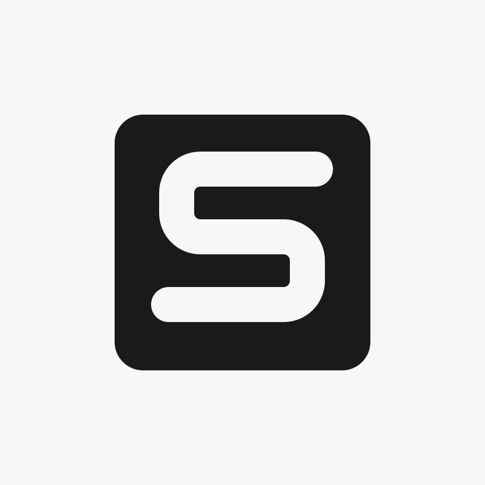

# Modern Logo Design

[简体中文](README.md) | **English**

A Claude skill for designing modern product logos: **skeleton first, color later**. Translating fuzzy brand ideas into marks with Bauhaus inevitability, mathematical order, high-order curvature tension, and OS-grade craft.

<p align="center">
  
</p>
<p align="center"><sub>Example: rounded square with a negative-space S, redrawn as precise vector in stage 3.5</sub></p>

## Core Value Proposition: The First Principles of Logo Design

A logo is not an illustration or a decorative sticker—it is a distinct design object governed by intrinsic structural laws.

This skill translates intuitive, divergent brand ideas into the **inevitable first principles of authentic logos**:

- **Bauhaus Inevitability**: Every stroke is essential—one stroke more is redundancy; one stroke less is collapse. Imagery becomes the contour, not external decoration.
- **Mathematical Order**: All stems, arcs, and clearances share a strict baseline module $w$, built from disciplined boolean geometry.
- **High-Order Curvature (G²)**: Continuous curvature transitions (squircles) and taut arcs eliminate abrupt mechanical joints.
- **OS-Grade Durability**: **Skeleton first, color later**. The mark must stand resolute in pure monochrome and remain razor-sharp at 16px.

## What it does

Give it your product background. The skill derives imagery, generates candidates, helps you pick and refine one, applies color, and delivers a vector logo plus app-icon previews. You confirm at the end of every stage, and can step back at any time.

```
Stage 0    Setup              Check the image API
Stage 1    Brief              Product name, category, what to express, mark type
Stage 2    Monochrome matrix  Derive 3–4 directions → monochrome images → review page
Stage 3    Select & refine    Diagnose → local tweaks → lock 1 skeleton
Stage 3.5  SVG redraw         Claude redraws the skeleton as precise vector (recommended)
Stage 4    Color & deliver    Color diagnosis → role assignment → A/B/C schemes → app-icon preview
```

Three image providers are supported: **Gemini (Nano Banana)**, **ChatGPT (OpenAI image models)**, and **Doubao (Volcengine Ark Seedream)**.

> 💡 **Model Note (Personal Preference)**:
> - **Prompt Generation**: If you are hesitating between Claude and Gemini, we personally lean toward recommending Gemini models as the conversational Agent; to some degree, its prompts tend to offer richer spatial and conceptual imagination.
> - **Image Generation**: Supports Gemini, ChatGPT, Doubao, and other compatible models (simply select the corresponding provider in your setup).

## How to Converge on Your Desired Mark (Iteration Techniques)

Great logos are rarely hit in a single lottery roll. They are the result of disciplined, stepwise convergence: "derive skeleton → diagnose defects → control-variable micro-tweaks". If initial candidates fall short of your vision, we recommend two practical methods:

### Method 1: Screenshot Reference Logos & Specify Exactly What You Approve
Provide 1–2 screenshots of existing logos that embody the vibe you want. **Avoid simply saying "make it like this"**. Instead, explicitly break down which specific elements you approve:
- "I like how these two strokes interlock to create airy negative space."
- "I like the taut, upright curvature of this outer squircle corner."
- "I appreciate the generous whitespace-to-mark ratio."
Tell the AI: *"Extract this geometric momentum and structural relationship from the reference, but do not copy the literal graphics."* Let AI leverage mature structural geometry rather than superficial mimicry.

### Method 2: Use "Physical Adjectives" Instead of Vague Taste Words
When evaluating drafts, avoid subjective, high-dimensional words like "not premium enough", "lacks vibe", or "looks dated"—AI cannot tune concrete geometric parameters from taste words.
Consult `references/skeleton_axioms.md` to translate your feeling into observable, physical dimensions:
- **Tight vs. Loose**: Is the internal counter or negative-space slit too cramped or too dispersed?
- **Thick vs. Thin**: Is the primary stroke too skeletal (hairline fragility) or too bulky (clunky blockiness)?
- **Heavy vs. Light**: Is the visual center of gravity floating too high, or sinking too low?
- **Sharp vs. Soft**: Are the vertices abrupt mechanical right-angles (needing G² squircle continuity), or slack like casual hand-drawings (needing arc tension)?
Instruct the AI in physical terms (e.g., *"The lower half feels too bottom-heavy; widen the clearance by 15% and apply micro-radiuses to all vertices"*). When diagnosing problems, **use low-dimensional physical language**; avoid subjective taste words like "looks bad" or "not premium".

## Quick Start

### 1. Setup & Configuration (~1 minute)

```bash
# Clone to Claude's skills directory (gh is recommended for private repos)
gh repo clone LillyLiuJun/modern-logo-design ~/.claude/skills/modern-logo-design

# Install dependencies and initialize config
cd ~/.claude/skills/modern-logo-design
pip install -r requirements.txt
cp .env.example .env
```

Edit `.env`: set `IMAGE_PROVIDER` to your default model (`gemini` / `openai` / `doubao`), then supply that provider's key (supports custom relay endpoints):

| Provider | `IMAGE_PROVIDER` | Required Key | Optional Settings (Relay / Custom Model) |
|---|---|---|---|
| Gemini (Nano Banana) | `gemini` | `GEMINI_API_KEY` | `GEMINI_API_BASE_URL`, `GEMINI_MODEL` |
| ChatGPT (OpenAI) | `openai` | `OPENAI_API_KEY` | `OPENAI_API_BASE_URL`, `OPENAI_MODEL` |
| Doubao (Seedream) | `doubao` | `DOUBAO_API_KEY` | `DOUBAO_API_BASE_URL`, `DOUBAO_MODEL` |

Verify the setup (validates the key online without generating images or consuming quota):
```bash
python scripts/check_env.py
```
When you see "environment ready", you're all set.

### 2. Start Designing

In your Claude Code / Agent conversation, just say it, with the background written out in one go (the more specific, the more focused and less generic the directions):

> **Full Prompt Example (Poplex):**
>
> Design a logo for "Poplex":
> 1. **Name**: Poplex (capital P).
> 2. **Category & Context**: An iOS English-learning app for adults who want to use English in daily life. Positioning: *build language from your life*. It turns what you come across in your day into your own English, and is opened every day.
> 3. **What to convey**: Growth, accumulation, quiet restraint, a bookish editorial feel. Avoid the usual learning-app clichés: checkmarks, speech bubbles, A–Z letters, globes, light bulbs.
> 4. **Mark type**: Pure symbol. I'd like to see this kind of "growth" imagery first, using elements made from the letter P and a sprout.
> 5. **Existing material (optional)**: A few app screenshots and the current P + ink-dot mark, as tonal reference rather than something to copy.
>
> Color is optional. If you give brand colors upfront (e.g. warm paper `#FBF8F5`, brand orange `#FF7622`, ink `#2A2320`), they are used when generating. If color gets in the way of judging the shape, switch back to monochrome, or keep refining color in stage 4.

These five points map one-to-one onto the skill's "Stage 1: Brief", so writing them all upfront avoids follow-up questions. For anything you haven't decided, just write "unsure, you recommend".

The skill will deduce 3–4 distinct structural directions, enter the skeleton stage, and assemble interactive HTML review pages at each round for visual comparison and diagnosis.

## Scripts (Advanced / Manual Debugging)

> **Note**: In normal use, the AI orchestrates these scripts automatically. Regular users **do not need to run these commands manually**. They are documented here for debugging, offline generation, or workflow integration.

### Generate images

```bash
# Skeleton stage: text-only prompts
python scripts/generate_image.py --name A1 --prompt-file A1.en.txt --prompt-zh-file A1.zh.txt

# Color stage: pass the confirmed skeleton to lock the shape
python scripts/generate_image.py --name A1-color --stage color --ref output/A1.png --prompt-file c.en.txt

# Switch provider for one run
python scripts/generate_image.py --provider doubao --name A1 --prompt "..."

# Inspect the request without calling the API
python scripts/generate_image.py --dry-run --prompt "..."
```

Each image gets a sibling `.json` recording the Chinese and English prompts, the model, and any reference images.

### Other tools (none call an API)

```bash
# Review page: images + design rationale + Chinese/English prompts (only assembles the page)
python scripts/build_review.py --names A1 B1 C1 --title "Name · Skeleton round 1" --out output/round1.html

# SVG: render and compare with the source image / recolor by layer
python scripts/render_svg.py output/A3.svg --source output/A3.png --name A3-svg
python scripts/render_svg.py output/A3.svg --name A3-c1 --colors "skeleton=#17120C,focus=#FF7622,bg=#FAF7F2"

# Color diagnosis: lightness, chroma, warmth, pairwise contrast, gradient suitability
python scripts/color_check.py "#211811" "#FFF5EF" "#FF7622"

# App-icon preview: light / dark backgrounds at 180 / 64 / 32 / 16 px
python scripts/make_preview.py output/A1.png
```

## Layout

```
modern-logo-design/
├── SKILL.md                    # Workflow (stages 0–4)
├── README.md / README.en.md    # Chinese / English docs
├── LICENSE                     # MIT License
├── .env.example                # API config template
├── requirements.txt
├── assets/
│   └── example_svg_s_office.svg  # SVG redraw example
├── references/
│   ├── skeleton_axioms.md      # Skeleton axioms: derivation and diagnosis
│   ├── svg_redraw.md           # SVG redraw: conventions, steps, comparison, coloring
│   ├── color_dressing.md       # Coloring: diagnosis, roles, three schemes, checks
│   └── prompt_templates.md     # Chinese/English prompt templates
└── scripts/
    ├── _config.py              # Reads .env
    ├── check_env.py            # Environment check
    ├── generate_image.py       # Image generation
    ├── build_review.py         # Review page
    ├── render_svg.py           # SVG render, compare, per-layer coloring
    ├── color_check.py          # Color diagnosis
    ├── make_preview.py         # App-icon preview
    └── providers/              # Provider connectors
        ├── gemini.py
        ├── openai_images.py
        └── doubao.py
```

## License

This project is licensed under the [MIT License](LICENSE).

