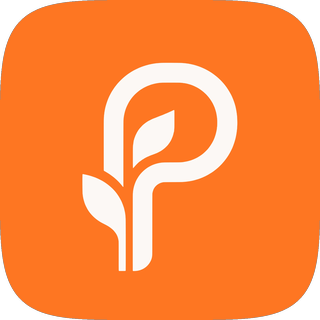
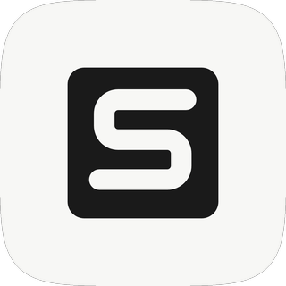

# Modern Logo Design

**English** | [简体中文](README.zh-CN.md)

A skill for designing modern product logos: **skeleton first, color later**. Translating fuzzy brand ideas into marks with Bauhaus inevitability, mathematical order, high-order curvature tension, and OS-grade craft.

<table align="center">
  <tr>
    <td align="center" width="25%">
      <br>
      <sub>Poplex<br>letter + sprout</sub>
    </td>
    <td align="center" width="25%">
      <br>
      <sub>Rounded square<br>negative-space S</sub>
    </td>
    <td align="center" width="25%">
      <br>
      <sub>Tree mark<br>light</sub>
    </td>
    <td align="center" width="25%">
      <br>
      <sub>Tree mark<br>reversed</sub>
    </td>
  </tr>
</table>

## Core Value Proposition: The First Principles of Logo Design

A logo is not an illustration or a decorative sticker—it is a distinct design object governed by intrinsic structural laws.

This skill translates intuitive, divergent brand ideas into the **inevitable first principles of authentic logos**:

- **Bauhaus Inevitability**: Every stroke is essential—one stroke more is redundancy; one stroke less is collapse. Imagery becomes the contour, not external decoration.
- **Mathematical Order**: All stems, arcs, and clearances share a strict baseline module $w$, built from disciplined boolean geometry.
- **High-Order Curvature (G²)**: Continuous curvature transitions (squircles) and taut arcs eliminate abrupt mechanical joints.
- **OS-Grade Durability**: **Skeleton first, color later**. The mark must stand resolute in pure monochrome and remain razor-sharp at 16px.

## What it does

Give it your product background. The skill derives imagery, generates candidates, helps you pick and refine one, applies color, and delivers a vector logo plus app-icon previews. You confirm at the end of every stage, and can step back at any time.

```
Stage 0    Setup              Check the image API
Stage 1    Brief              Product name, category, what to express, mark type
Stage 2    Monochrome matrix  Derive 3–4 directions → monochrome images → review page
Stage 3    Select & refine    Diagnose → local tweaks → lock 1 skeleton
Stage 3.5  SVG redraw         Claude redraws the skeleton as precise vector (recommended)
Stage 4    Color & deliver    Color diagnosis → role assignment → A/B/C schemes → app-icon preview
```

Three image providers are supported: **Gemini (Nano Banana)**, **ChatGPT (OpenAI image models)**, and **Doubao (Volcengine Ark Seedream)**.

> 💡 **Tip**: as the conversational agent that writes the prompts, we find Gemini a little more imaginative than Claude in spatial and conceptual terms.

## Quick Start

### 1. Install

Paste this to Claude Code (or any agent that supports skills):

> Install the skill from https://github.com/LillyLiuJun/modern-logo-design into ~/.claude/skills/modern-logo-design, install its dependencies, and create the .env file from .env.example. Then tell me which file to open and which key to fill in. Do not ask me to paste my key in the chat.

Then open `.env`, set `IMAGE_PROVIDER` (`gemini`, `openai` or `doubao`) and fill in that provider's key (`GEMINI_API_KEY`, `OPENAI_API_KEY` or `DOUBAO_API_KEY`). Leave the other fields alone; only fill in `*_API_BASE_URL` if you use a third-party relay.

<details>
<summary>Manually install</summary>

```bash
git clone https://github.com/LillyLiuJun/modern-logo-design.git ~/.claude/skills/modern-logo-design
cd ~/.claude/skills/modern-logo-design
pip install -r requirements.txt
cp .env.example .env
```

</details>

### 2. Start Designing

Tell your agent what you are making (example: Poplex):

> Design a logo for "Poplex":
> 
> - **Name**: Poplex (capital P).
> - **Category & Context**: An iOS English-learning app for adults who want to use English in daily life. Positioning: *build language from your life*. It turns what you come across in your day into your own English, and is opened every day.
> - **What to convey**: Growth, accumulation, quiet restraint, a bookish editorial feel. Avoid the usual learning-app clichés: checkmarks, speech bubbles, A–Z letters, globes, light bulbs.
> - **Mark type**: Pure symbol. I'd like to see this kind of "growth" imagery first, using elements made from the letter P and a sprout.
> - **Existing material (optional)**: A few app screenshots and the current P + ink-dot mark, as tonal reference rather than something to copy.
> - **Color (optional)**: e.g. warm paper `#FBF8F5`, orange `#FF7622`, ink `#2A2320`. Used when generating; if color gets in the way of judging the shape, the skill falls back to monochrome and refines color in stage 4.

These map to the skill's Stage 1: Brief. For anything undecided, write "unsure, you recommend". The skill then derives 3–4 distinct directions and builds an HTML review page each round.

## How to Converge on the Mark You Want

Great logos are rarely hit in one roll. They converge: derive a skeleton, diagnose it, change one thing. Two techniques help:

**1. Show a reference, and say what you like about it.**
Share 1–2 screenshots with the right feel, and name the part you approve instead of saying "like this": the interlocking strokes, the taut squircle corner, the generous whitespace. Then ask the AI to borrow the geometry, not copy the graphic.

**2. Describe problems in physical terms, not taste words.**
"Not premium enough" gives the AI nothing to adjust. Use the dimensions in `references/skeleton_axioms.md`:

- **Tight / loose**: is the counter or slit too cramped or too scattered?
- **Thick / thin**: are the strokes hairline-fragile or clunky?
- **Heavy / light**: does the center of gravity sit too high or too low?
- **Sharp / soft**: are the corners mechanical, or slack?

For example: *"The lower half is bottom-heavy; widen the clearance by 15% and soften the vertices."*

## Layout

```
modern-logo-design/
├── SKILL.md                    # Workflow (stages 0–4)
├── README.md / README.zh-CN.md # English / Chinese docs
├── LICENSE                     # MIT License
├── .env.example                # API config template
├── requirements.txt
├── assets/
│   ├── example_svg_s_office.svg  # SVG redraw example
│   └── showcase/                 # Logos shown at the top of the README
├── references/
│   ├── skeleton_axioms.md      # Skeleton axioms: derivation and diagnosis
│   ├── svg_redraw.md           # SVG redraw: conventions, steps, comparison, coloring
│   ├── color_dressing.md       # Coloring: diagnosis, roles, three schemes, checks
│   └── prompt_templates.md     # Prompt templates (English; optional translation line)
└── scripts/
    ├── _config.py              # Reads .env
    ├── check_env.py            # Environment check
    ├── generate_image.py       # Image generation
    ├── build_review.py         # Review page
    ├── render_svg.py           # SVG render, compare, per-layer coloring
    ├── color_check.py          # Color diagnosis
    ├── make_preview.py         # App-icon preview
    └── providers/              # Provider connectors
        ├── gemini.py
        ├── openai_images.py
        └── doubao.py
```

## Contributing

Issues and pull requests are welcome. See [CONTRIBUTING.md](CONTRIBUTING.md).

## License

This project is licensed under the [MIT License](LICENSE).

